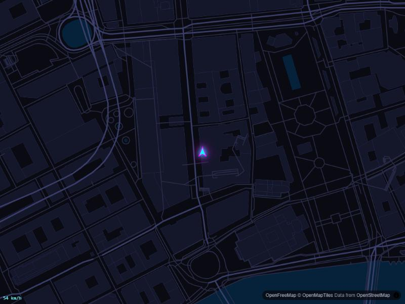

# NFS-Nav

A stylized, game-inspired **minimap for a car head unit**. NFS-Nav shows a dark, neon-accented vector map with a glowing car marker that follows your position, built as a web app that is packaged as an Android APK. Target hardware is a Blaupunkt Key Largo 970 (Android 9) in a VW Polo, but it runs in any WebGL-capable browser.



*Dark OpenStreetMap-based map with the car marker (simulator mode, Stockholm).*

> **Status: early development (roadmap step 1 of 11).** The app currently runs on a built-in simulator, not real GPS. A debug APK builds and installs on the head unit once its "closed system" option is switched off (see [Known issues](#known-issues)).

## Features (so far)

- Dark vector map (MapLibre GL JS, OpenFreeMap tiles, OpenStreetMap data) in a custom neon-on-dark style
- Glowing car marker that rotates with heading
- Simulated drive on a loop with varying speed and optional GPS dropout (`?dropout`)
- Smooth motion: ~1 Hz position samples interpolated every frame, 30 fps cap
- WebGL feature detection with a fallback screen
- Capacitor Android wrapper and a USB packaging script

## Quick start

Requires Node.js 20+.

```bash
npm install
npm run dev        # http://localhost:5173, runs with the simulator
npm test           # unit tests (vitest)
npm run build      # typecheck + production build (modern + legacy bundles)
```

### Build the Android APK

Needs JDK 17 and the Android SDK. Create `android/local.properties` with `sdk.dir=<path to your Android SDK>`.

```bash
npm run android:apk   # debug APK: android/app/build/outputs/apk/debug/app-debug.apk
npm run pack:usb      # copies it to dist-usb/nfs-nav.apk for a USB stick
```

## How it works

Vehicle data enters only through a `VehicleDataSource` interface (simulator now; GPS and OBD-II later). A single state store feeds the map and, later, HUD widgets. See [CLAUDE.md](CLAUDE.md) for the architecture, theme-pack spec, safety rules and the full roadmap.

```
src/
  core/   state store, config, geo math
  data/   VehicleDataSource + simulator
  map/    MapLibre style, car marker, interpolation
```

## Roadmap

1. Scaffold with simulator-driven car on a dark map (done)
2. Camera rig: heading-up, pitch, speed-based zoom
3. Theme system with an `nfs-underground` pack
4. HUD widgets (speed, clock, compass, street name)
5. Real GPS via Capacitor
6. Routing and route line
7. Offline tile cache
8. Android packaging and install guide
9. On-device tuning
10. Laptop theme builder
11. Optional OBD-II data

## Known issues

- The Key Largo 970 blocks third-party APKs by default. Installing works after switching off the "closed system" option in Settings > General > Factory Settings > Other settings. Details in [CLAUDE.md](CLAUDE.md).
- `maplibre-gl` is pinned to 4.x for old-WebView (WebGL1) compatibility. `npm audit` reports an HTML sanitizer advisory in this version; the app does not render untrusted HTML.

## Safety

This is a driver display. It must not require attention while the car is moving, and it does not gamify real driving. Use apps on the unit only while parked.

## Attribution and licensing

Map data © [OpenStreetMap contributors](https://www.openstreetmap.org/copyright), tiles by [OpenFreeMap](https://openfreemap.org) / [OpenMapTiles](https://openmaptiles.org). No Electronic Arts / Need for Speed assets or trademarks are used; the visual style is only inspired by the genre. No license has been chosen yet.
