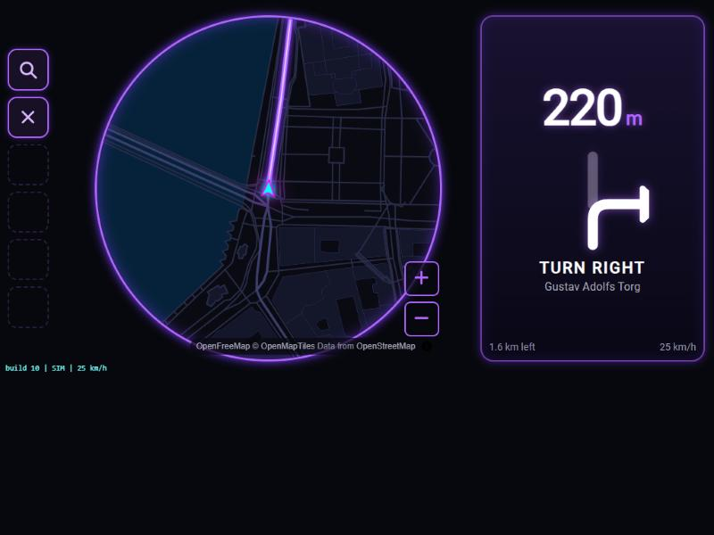
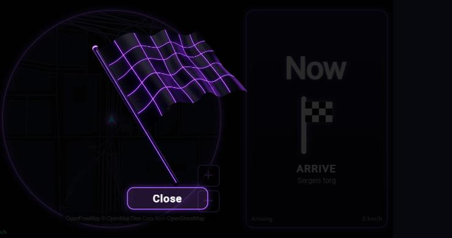
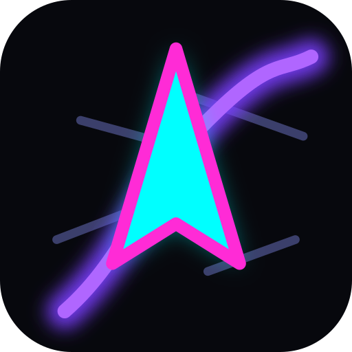

# NFS-Nav

A stylized, game-inspired **minimap for a car head unit**. NFS-Nav shows a dark, neon-accented vector map with a glowing car marker that follows your position, built as a web app that is packaged as an Android APK. Target hardware is a Blaupunkt Key Largo 970 (Android 9) in a VW Polo, but it runs in any WebGL-capable browser.



*Navigating (simulator, Stockholm): six buttons on the left, circular neon minimap in the middle, live turn-by-turn on the right.*



*Arrival popup: the neon flag and a Close button; Close also clears the route.*

> **Status: early development (roadmap step 5 of 11).** The map runs on the head unit. The installed app uses the unit's GPS; the desktop dev server uses a simulator (use `?gps` to try browser geolocation). A debug APK builds and installs on the head unit once its "closed system" option is switched off (see [Known issues](#known-issues)).



## Features (so far)

- Dark vector map (MapLibre GL JS, OpenFreeMap tiles, OpenStreetMap data) in a custom neon-on-dark style
- Destination search (Photon / OpenStreetMap) with live suggestions, routing (OSRM), automatic rerouting
- Neon purple glowing route on the map with a chequered finish flag; the driven part of the line disappears behind the car
- Live turn-by-turn panel: just the distance to the next turn (counting down) and an Apple-style symbol for it (straight, slight/normal/sharp left and right, U-turns)
- Arrival popup with a neon checkered flag and a Close button (Close clears the route from the map)
- Search is locked while the car moves (safety)
- Lyrics mode (music button): a Spotify-style lyrics card in the right panel that scrolls and highlights in time with the song. The lyrics screen and sync are built; connecting it to the Spotify account is still to do
- Heading-up camera: the map rotates so your direction of travel always points up (smoothed; `?north` for north-up)
- Pinch-to-zoom (remembered) and a Map button that switches between the circular minimap and a full-screen map; the car stays in the same spot on screen
- Glassmorphism turn panel (frosted blur where the browser supports it, tinted glass on older WebViews)
- Glowing car marker that rotates with heading
- Real GPS from the device (`navigator.geolocation`) with accuracy filtering, heading smoothing and a "GPS signal lost" banner
- Simulated drive on a loop with varying speed and optional GPS dropout (`?dropout`)
- Smooth motion: ~1 Hz position samples interpolated every frame, 30 fps cap
- WebGL feature detection with a fallback screen
- Custom launcher icon (original artwork, generated by `tools/icons/make-icons.mjs`)
- Capacitor Android wrapper and a USB packaging script

## Quick start

Requires Node.js 20+.

```bash
npm install
npm run dev        # http://localhost:5173, runs with the simulator
npm test           # unit tests (vitest)
npm run build      # typecheck + production build (modern + legacy bundles)
```

### Build the Android APK

Needs JDK 17 and the Android SDK. Create `android/local.properties` with `sdk.dir=<path to your Android SDK>`.

```bash
npm run android:apk   # debug APK: android/app/build/outputs/apk/debug/app-debug.apk
npm run pack:usb      # copies it to dist-usb/nfs-nav.apk for a USB stick
```

## How it works

Vehicle data enters only through a `VehicleDataSource` interface (simulator now; GPS and OBD-II later). A single state store feeds the map and, later, HUD widgets. See [CLAUDE.md](CLAUDE.md) for the architecture, theme-pack spec, safety rules and the full roadmap.

```
src/
  core/   state store, config, geo math
  data/   VehicleDataSource + simulator
  map/    MapLibre style, car marker, interpolation
```

## Roadmap

1. Scaffold with simulator-driven car on a dark map (done)
2. Camera rig: heading-up (done), pitch, speed-based zoom, look-ahead
3. Theme system with an `nfs-underground` pack
4. HUD widgets (speed, clock, compass, street name)
5. Real GPS via Capacitor
6. Routing and route line
7. Offline tile cache
8. Android packaging and install guide
9. On-device tuning
10. Laptop theme builder
11. Optional OBD-II data

## Known issues

- The Key Largo 970 blocks third-party APKs by default. Installing works after switching off the "closed system" option in Settings > General > Factory Settings > Other settings. Details in [CLAUDE.md](CLAUDE.md).
- `maplibre-gl` is pinned to 2.4.0 because the head unit WebView is Chrome 61 (WebGL1 only). `npm audit` reports advisories for this old version; the app does not render untrusted HTML.

## Privacy and services

Search queries and your position (to bias results and to route) are sent to the public Photon geocoder and the public OSRM routing demo server. Both are dev-grade public services; for real use, self-host them or swap the providers (see `src/nav/`). Map tiles come from OpenFreeMap. Google Maps/Places is intentionally not used.

## Safety

This is a driver display. It must not require attention while the car is moving, and it does not gamify real driving. Use apps on the unit only while parked.

## Attribution and licensing

Map data © [OpenStreetMap contributors](https://www.openstreetmap.org/copyright), tiles by [OpenFreeMap](https://openfreemap.org) / [OpenMapTiles](https://openmaptiles.org). No Electronic Arts / Need for Speed assets or trademarks are used; the visual style is only inspired by the genre. No license has been chosen yet.
